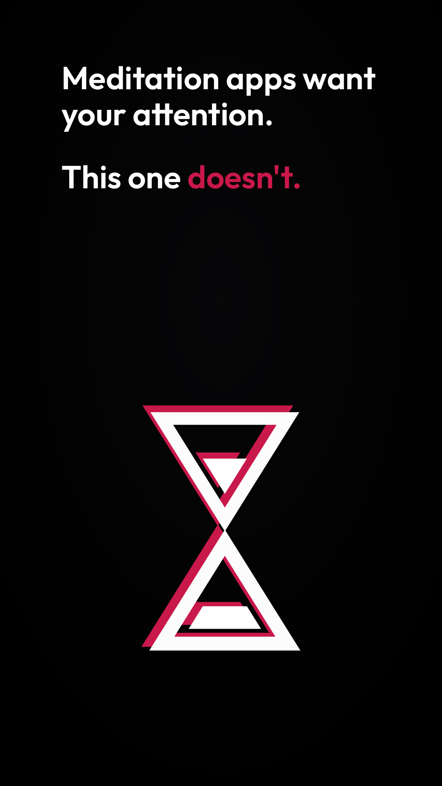
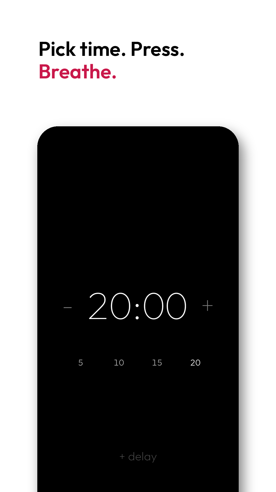
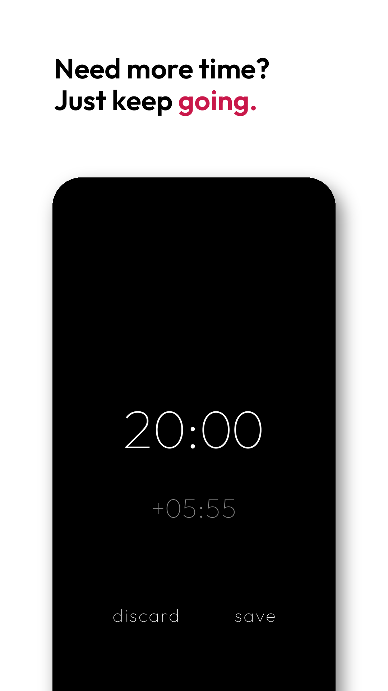
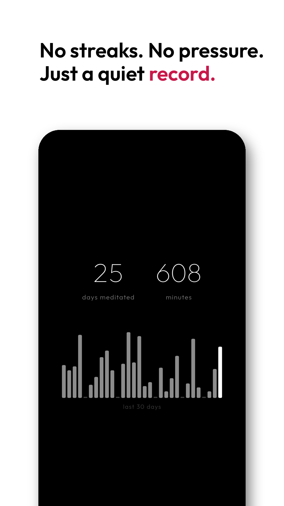

# Mars Timer

[](https://play.google.com/store/apps/details?id=com.catchingclouds.marstimer)

A meditation timer that stays out of the way. A bell to start, a bell to end. No guided voices, no gamification, no menus.

I meditated for years with apps that got more cluttered with every update. I only wanted a timer.

<p>
  
  
  
  
  
</p>

## What it does

- Quick-select durations you can edit, or adjust by the minute.
- An optional delay before the first bell, so you can settle in.
- Keep sitting past the bell. Overtime counts toward your total.
- Tap to pause and resume. The screen stays on during a session.
- Minutes and days meditated, with no streaks. A quiet record, not something to keep up.
- No subscription, no account, no tracking. Nothing leaves your phone.

## Build

You need the [Flutter SDK](https://docs.flutter.dev/get-started/install).

```bash
./install_debug.sh
./install_release.sh
```

## Under the hood

Flutter and Dart. `TimerProvider` (Provider) drives the timer state, sessions are stored in SQLite via sqflite, the bell plays through `audioplayers`, and the last duration is kept in SharedPreferences. See [CLAUDE.md](CLAUDE.md).

Part of [Mars](https://github.com/libaum/mars), a family of small, calm apps.

## License

MIT
